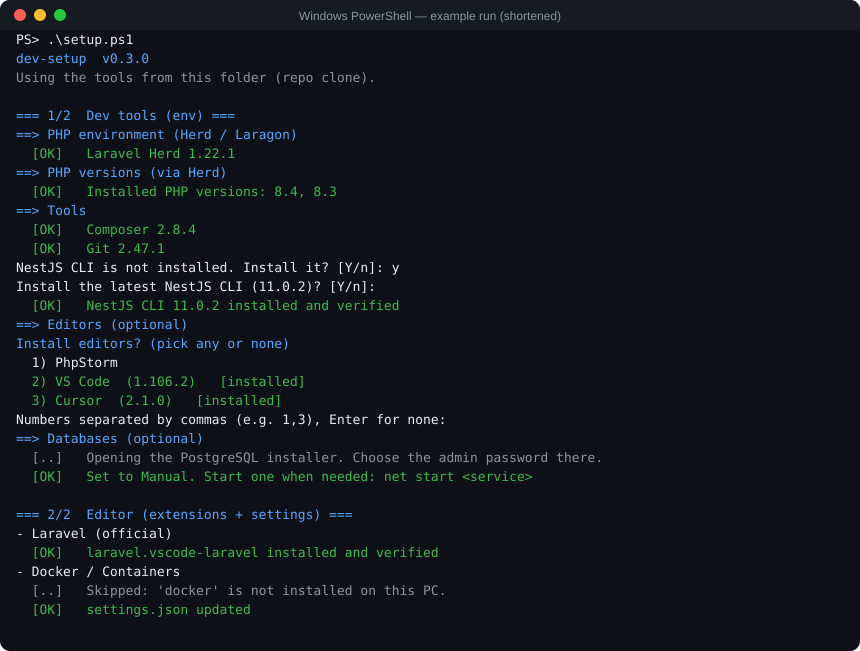

[English](README.md)

<div dir="rtl">

# dev-setup

[](https://github.com/Eslam-Nazer/dev-setup/releases/latest)
[](https://github.com/Eslam-Nazer/dev-setup/actions/workflows/ci.yml)
[](https://github.com/Eslam-Nazer/dev-setup/actions/workflows/catalog-check.yml)
[](LICENSE)

سكربتات لتجهيز جهاز Windows للتطوير بـ **Laravel + NestJS** (PHP / TypeScript): أدوات التطوير، والمحررات، وقواعد البيانات، وإضافات المحرر وإعداداته. السكربت يفحص ما هو مثبّت عندك، ويسألك قبل كل تثبيت، ويبقى خفيفًا على جهازك.



| الأداة | وظيفتها |
|---|---|
| [`setup.ps1`](setup.ps1) | **أمر واحد**: يشغّل `env` ثم `editor` |
| [`env/`](env/) | يفحص ويثبّت أدوات التطوير: Herd / Laragon / PHP الرسمي، Composer، Git، Node.js، NestJS CLI، Docker، المحررات (PhpStorm, VS Code, Cursor)، قواعد البيانات (PostgreSQL, MySQL, MariaDB, Redis, MongoDB) وواجهات قواعد البيانات الرسومية |
| [`editor/`](editor/) | إضافات وإعدادات Cursor / VS Code لـ Laravel + NestJS، مع خيار لإحساس PhpStorm |

## البدء السريع

**أمر واحد** (PowerShell على Windows 10/11):

</div>

```powershell
irm https://github.com/Eslam-Nazer/dev-setup/releases/latest/download/setup.ps1 -OutFile setup.ps1
powershell -NoProfile -ExecutionPolicy Bypass -File .\setup.ps1
```

<div dir="rtl">

يقوم `setup.ps1` بتنزيل الأداتين من الإصدار نفسه و**يتحقق منهما عبر `SHA256SUMS.txt`** قبل تشغيلهما. اضغط Enter لقبول كل خيار افتراضي.

جرّبه أولًا دون تغيير أي شيء:

</div>

```powershell
.\setup.ps1 -DryRun -Target both     # are all packages and extensions available? installs nothing
```

<div dir="rtl">

طرق أخرى:

- **ملف Zip:** نزّل `dev-setup-env-vX.Y.Z.zip` / `dev-setup-editor-vX.Y.Z.zip` من [آخر إصدار](https://github.com/Eslam-Nazer/dev-setup/releases/latest)، وفك الضغط، ثم اضغط مرتين على ملف `.bat`.
- **Clone:** نفّذ `git clone https://github.com/Eslam-Nazer/dev-setup` ثم اضغط مرتين على `setup.bat`.
- **أداة واحدة فقط:** `releases/latest/download/setup-dev-env.ps1` أو `.../setup-dev-extensions.ps1`.

تحقق من الملف الذي نزّلته بنفسك:

</div>

```powershell
(Get-FileHash .\setup.ps1 -Algorithm SHA256).Hash   # compare with SHA256SUMS.txt in the release
```

<div dir="rtl">

| الخيار (`setup.ps1`) | المعنى |
|---|---|
| `-DryRun` | يفحص التوفّر فقط؛ لا يثبّت ولا يغيّر شيئًا |
| `-Yes` | يقبل كل الخيارات الافتراضية (الأشياء الثقيلة الاختيارية مثل Docker والمحررات وقواعد البيانات تبقى متوقفة) |
| `-Target cursor\|code\|both` | أي محرر تريد إعداده |
| `-Source phpstorm\|vscode\|recommended\|author` | مصدر إعدادات المحرر |
| `-SkipEnv` / `-SkipEditor` | تشغيل أداة واحدة فقط |
| `-Version` | يطبع رقم الإصدار |

التوثيق: [تنظيم المستودع](docs/architecture.md) | [استخدام Env](docs/env/usage.md) | [استخدام Editor](docs/editor/usage.md) | [الاختبار](docs/testing.md) | [المساهمة](CONTRIBUTING.md) | [الأمان](SECURITY.md)

---

## أداة Env (`env/`)

تفحص Herd / Laragon / PHP، وComposer، وGit، وNode.js، وNestJS CLI، وDocker Desktop، وتثبّت الناقص (عبر winget) مع سؤالك قبل كل تثبيت.

</div>

```powershell
powershell -NoProfile -ExecutionPolicy Bypass -File .\env\setup-dev-env.ps1
```

<div dir="rtl">

استخدم `-CheckOnly` للتقرير فقط، و`-DryRun` للتأكد أن كل package id ما زال متاحًا. التفاصيل الكاملة: [docs/env/usage.md](docs/env/usage.md).

---

## إعداد المحرر (`editor/`)

### البدء السريع (من نسخة clone)

1. اعمل clone لهذا المستودع على Windows.
2. اضغط مرتين على `editor\setup-dev-extensions.bat`.
3. أجب عن الأسئلة (اضغط Enter للخيار الافتراضي).
4. أعد تشغيل المحرر.

أو من PowerShell:

</div>

```powershell
powershell -NoProfile -ExecutionPolicy Bypass -File .\editor\setup-dev-extensions.ps1
```

<div dir="rtl">

### ماذا يسأل

1. التثبيت في Cursor أو VS Code أو كليهما
2. مصدر الإعدادات: PhpStorm على هذا الجهاز، أو VS Code على هذا الجهاز، أو **الإعدادات الموصى بها** (محايدة: تحافظ على الثيم والتخطيط والاختصارات) أو **إعدادات المؤلف** (ثيم poimandres، تبويبات مدمجة، smooth caret)
3. هل تريد تغيير ثيم الألوان
4. هل تريد ضبط PHP interpreter، وهل تستخدم أحدث PHP موجود أو تختار إصدارًا
5. هل تريد تطبيق إعدادات الأداء، والإعدادات الموصى بها للمحرر، واختصارات بنمط PhpStorm، وأيقونات JetBrains (كل واحد يُسأل عنه على حدة؛ لا يُطبَّق شيء مفروض بصمت)
6. أي إضافة لقواعد البيانات تريد إضافتها، إن وُجدت

### المزايا

- يتحقق من وجود كل إضافة (Open VSX لـ Cursor، وMarketplace لـ VS Code)
- يتجاوز الإضافات المهجورة (deprecated)، ويتبع البديل الرسمي، ويرجع إلى بدائل عند الحاجة
- يتحمل انقطاع الإنترنت (ينتظر ويعيد المحاولة) ويمكن استكماله (يتجاوز ما هو مثبّت)
- يتحقق من كل تثبيت
- ينسخ keymap والاختصارات المخصصة والثيم والواجهة المدمجة وsmooth caret وPHP interpreter من المصدر المختار
- Double Shift = بحث، Alt+Home = شريط التنقل breadcrumbs، Ctrl+Alt+N = ملف جديد في أي مسار
- أيقونات ملفات بنمط JetBrains، وإضافة Claude Code
- ينسخ احتياطيًا `settings.json` و`keybindings.json` قبل تغييرهما؛ و`-Restore` يعيد نسخة احتياطية
- `-DryRun` يفحص كل إضافة (موجودة، وغير مهجورة) دون تثبيت أي شيء

### التوثيق

- [الاستخدام والخيارات](docs/editor/usage.md)
- [تخصيص السكربت](docs/editor/customize.md)
- [الإضافات المثبّتة](docs/editor/extensions.md)

### المتطلبات

- Windows 10/11 وPowerShell 5.1+
- Cursor و/أو VS Code مع CLI الخاص به في PATH (`cursor` / `code`).
  إن لم يكن موجودًا: افتح المحرر ثم `Ctrl+Shift+P` ثم *Install 'cursor' command in PATH*.

---

## الإصدارات

- [Changelog](CHANGELOG.md)
- [الاختبار](docs/testing.md): فحوصات تلقائية على Windows حقيقي (مع كل push وأسبوعيًا)، وحزمة Windows Sandbox للاختبار اليدوي
- [كيف تعمل الإصدارات](docs/releasing.md): `.\build\bump-version.ps1 -Version X.Y.Z -Commit` ثم `git push` (الـ workflow ينشئ الوسم والإصدار)

---

## خفيف بالتصميم

خفيف على الجهاز أولًا، ثم على الجيب.

- **السكربتات نفسها**: يتم التحقق من التثبيت بفحص مجلد الإضافة، لا بتشغيل المحرر مرة أخرى (كل استدعاء لـ CLI المحرر يكلّف نحو 150 MB من RAM)؛ وينتظر الإنترنت بطلب صغير واحد كل 10 ثوانٍ.
- **المحرر بعد ذلك**: لا تتم مراقبة أو بحث `vendor` و`node_modules` و`storage` و`bootstrap/cache` و`dist` (أكبر توفير في CPU/القرص في مشاريع Laravel / NestJS)؛ يشغّل Jest الاختبارات عند الطلب لا مع كل حفظ؛ code lens الخاص بـ GitLens متوقف؛ وإضافة Docker تُثبَّت فقط إذا كان Docker موجودًا على الجهاز. إدخالاتك الخاصة في `files.watcherExclude` / `search.exclude` تبقى كما هي.
- كل ما يثبّته مجاني. يُستخدم Herd بنسخته المجانية؛ ولا حاجة لأي ميزة مدفوعة.
- يمكن تحويل خدمات قواعد البيانات إلى **Manual start** حتى لا تستهلك الذاكرة إلى أن تشغّلها.
- الأدوات الثقيلة أو الاختيارية (Docker Desktop: نحو 1 GB، يحتاج WSL 2، ومدفوع للشركات الكبيرة؛ قواعد البيانات؛ العملاء الرسوميون) **اختيارية**: السؤال افتراضيه No، و`-Yes` يتجاوزها.
- لا يُنزَّل شيء قبل موافقتك؛ والفحوصات تستخدم طلبات API صغيرة.
- الأدوات والإضافات المثبّتة مسبقًا يتم تجاوزها، فإعادة التشغيل سريعة.
- الترتيب: يُحتفظ فقط بآخر 10 سجلات لكل أداة (في `%LOCALAPPDATA%\dev-setup`) وآخر 5 نسخ احتياطية من `settings.json` / `keybindings.json`.

## المساهمة والأمان

التقارير عن الأخطاء والأفكار مرحّب بها: استخدم قوالب issues. راجع [CONTRIBUTING.md](CONTRIBUTING.md).
للمشاكل الأمنية: راجع [SECURITY.md](SECURITY.md).

## الرخصة

MIT، راجع [LICENSE](LICENSE).

</div>
