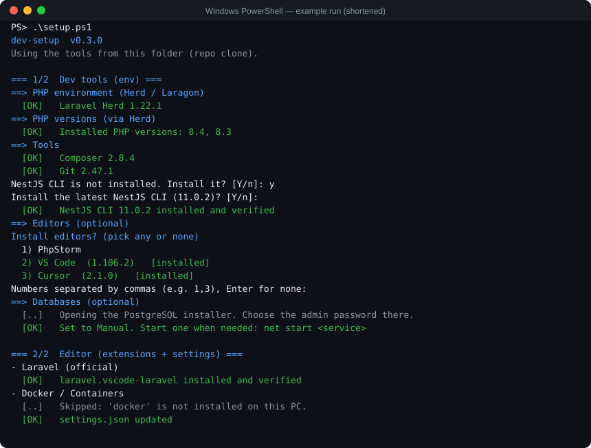

# dev-setup

[](https://github.com/Eslam-Nazer/dev-setup/releases/latest)
[](https://github.com/Eslam-Nazer/dev-setup/actions/workflows/ci.yml)
[](https://github.com/Eslam-Nazer/dev-setup/actions/workflows/catalog-check.yml)
[](LICENSE)

Scripts to set up a Windows dev machine for **Laravel + NestJS** (PHP / TypeScript): dev tools, editors,
databases, editor extensions and settings. It checks what you already have, asks before every install,
and stays light on your machine.

[العربية](README.ar.md)



| Tool | What it does |
|---|---|
| [`setup.ps1`](setup.ps1) | **One command**: runs `env`, then `editor` |
| [`env/`](env/) | Checks and installs dev tools: Herd / Laragon / official PHP, Composer, Git, Node.js, NestJS CLI, Docker, editors (PhpStorm, VS Code, Cursor), databases (PostgreSQL, MySQL, MariaDB, Redis, MongoDB) and DB GUI clients |
| [`editor/`](editor/) | Cursor / VS Code extensions and settings for Laravel + NestJS, with an optional PhpStorm feel |

## Quick start

**One command** (PowerShell, Windows 10/11):

```powershell
irm https://github.com/Eslam-Nazer/dev-setup/releases/latest/download/setup.ps1 -OutFile setup.ps1
powershell -NoProfile -ExecutionPolicy Bypass -File .\setup.ps1
```

`setup.ps1` downloads the two tools from the same release and **verifies them against `SHA256SUMS.txt`**
before running them. Press Enter to accept each default.

Try it without changing anything first:

```powershell
.\setup.ps1 -DryRun -Target both     # are all packages and extensions available? installs nothing
```

Other ways:

- **Zip:** download `dev-setup-env-vX.Y.Z.zip` / `dev-setup-editor-vX.Y.Z.zip` from the
  [latest release](https://github.com/Eslam-Nazer/dev-setup/releases/latest), unzip, double-click the `.bat`.
- **Clone:** `git clone https://github.com/Eslam-Nazer/dev-setup` then double-click `setup.bat`.
- **One tool only:** `releases/latest/download/setup-dev-env.ps1` or `.../setup-dev-extensions.ps1`.

Check a download yourself:

```powershell
(Get-FileHash .\setup.ps1 -Algorithm SHA256).Hash   # compare with SHA256SUMS.txt in the release
```

| Option (`setup.ps1`) | Meaning |
|---|---|
| `-DryRun` | Only check availability; install and change nothing |
| `-Yes` | Accept every default (optional heavy things like Docker, editors and databases stay off) |
| `-Target cursor\|code\|both` | Which editor to configure |
| `-Source phpstorm\|vscode\|recommended\|author` | Where editor settings come from |
| `-SkipEnv` / `-SkipEditor` | Run only one of the tools |
| `-Version` | Print the version |

Docs: [How this repo is organized](docs/architecture.md) | [Env usage](docs/env/usage.md) | [Editor usage](docs/editor/usage.md) | [Testing](docs/testing.md) | [Contributing](CONTRIBUTING.md) | [Security](SECURITY.md)

---

## Env tool (`env/`)

Checks Herd / Laragon / PHP, Composer, Git, Node.js, NestJS CLI and Docker Desktop, and installs what is missing
(with winget), asking before each install.

```powershell
powershell -NoProfile -ExecutionPolicy Bypass -File .\env\setup-dev-env.ps1
```

Use `-CheckOnly` to only report, `-DryRun` to check that every package id is still available.
Full details: [docs/env/usage.md](docs/env/usage.md).

---

## Editor setup (`editor/`)

### Quick start (from a clone)

1. Clone this repo on Windows.
2. Double-click `editor\setup-dev-extensions.bat`.
3. Answer the questions (press Enter for the default).
4. Restart the editor.

Or from PowerShell:

```powershell
powershell -NoProfile -ExecutionPolicy Bypass -File .\editor\setup-dev-extensions.ps1
```

### What it asks

1. Install into Cursor, VS Code, or both
2. Where to take settings from: PhpStorm on this PC, VS Code on this PC, **recommended defaults** (neutral: keeps your
   theme, layout and shortcuts) or the **author's preset** (poimandres theme, compact tabs, smooth caret)
3. Whether to change the color theme
4. Whether to set the PHP interpreter, and whether to use the latest PHP found or pick a version
5. Whether to apply performance settings, recommended editor settings, PhpStorm-style shortcuts and JetBrains icons
   (each asked separately; nothing opinionated is applied silently)
6. Which database extension to add, if any

### Features

- Checks each extension exists (Open VSX for Cursor, Marketplace for VS Code)
- Skips deprecated extensions, follows the official replacement, falls back to alternatives
- Survives internet drops (waits and retries) and is resumable (skips what is installed)
- Verifies every install
- Copies keymap, custom shortcuts, theme, compact UI, smooth caret and PHP interpreter from the chosen source
- Double Shift = search, Alt+Home = breadcrumbs nav bar, Ctrl+Alt+N = new file at any path
- JetBrains-style file icons, Claude Code extension
- Backs up `settings.json` and `keybindings.json` before changing them; `-Restore` puts a backup back
- `-DryRun` checks every extension (exists, not deprecated) without installing anything

### Docs

- [Usage and options](docs/editor/usage.md)
- [Customizing the script](docs/editor/customize.md)
- [Extensions installed](docs/editor/extensions.md)

### Requirements

- Windows 10/11, PowerShell 5.1+
- Cursor and/or VS Code with its CLI in PATH (`cursor` / `code`).
  If missing: open the editor → `Ctrl+Shift+P` → *Install 'cursor' command in PATH*.

---

## Versions and releases

- [Changelog](CHANGELOG.md)
- [Testing](docs/testing.md): automatic checks on real Windows (every push + weekly), and a Windows Sandbox kit for manual tests
- [How versions and releases work](docs/releasing.md): `.\build\bump-version.ps1 -Version X.Y.Z -Commit` then `git push` (the workflow tags and releases)

---

## Lightweight by design

Light on the machine first, then on the wallet.

- **The scripts themselves**: installs are verified by checking the extension folder, not by starting the editor again
  (each editor CLI call costs ~150 MB RAM); waits for the internet with one small request every 10 s.
- **The editor afterwards**: `vendor`, `node_modules`, `storage`, `bootstrap/cache`, `dist` are not watched or searched
  (the biggest CPU/disk saver in Laravel / NestJS projects); Jest runs tests on demand, not on every save;
  GitLens code lens is off; the Docker extension is installed only when Docker is on the PC.
  Your own `files.watcherExclude` / `search.exclude` entries are kept.
- Everything it installs is free. Herd is used in its free edition; no paid feature is required.
- Database services can be switched to **Manual start**, so they don't use memory until you start them.
- Heavy or optional tools (Docker Desktop: ~1 GB, needs WSL 2, paid for larger companies; databases; GUI clients) are **opt-in**:
  the question defaults to No and `-Yes` skips them.
- Nothing is downloaded before you agree; checks use small API calls.
- Already-installed tools and extensions are skipped, so re-runs are quick.
- Housekeeping: only the 10 newest logs per tool (in `%LOCALAPPDATA%\dev-setup`) and the 5 newest `settings.json` / `keybindings.json` backups are kept.

## Contributing and security

Bug reports and ideas are welcome: use the issue templates. See [CONTRIBUTING.md](CONTRIBUTING.md).
Security problems: see [SECURITY.md](SECURITY.md).

## License

MIT, see [LICENSE](LICENSE).
