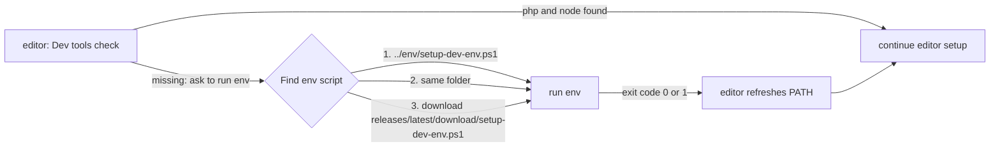
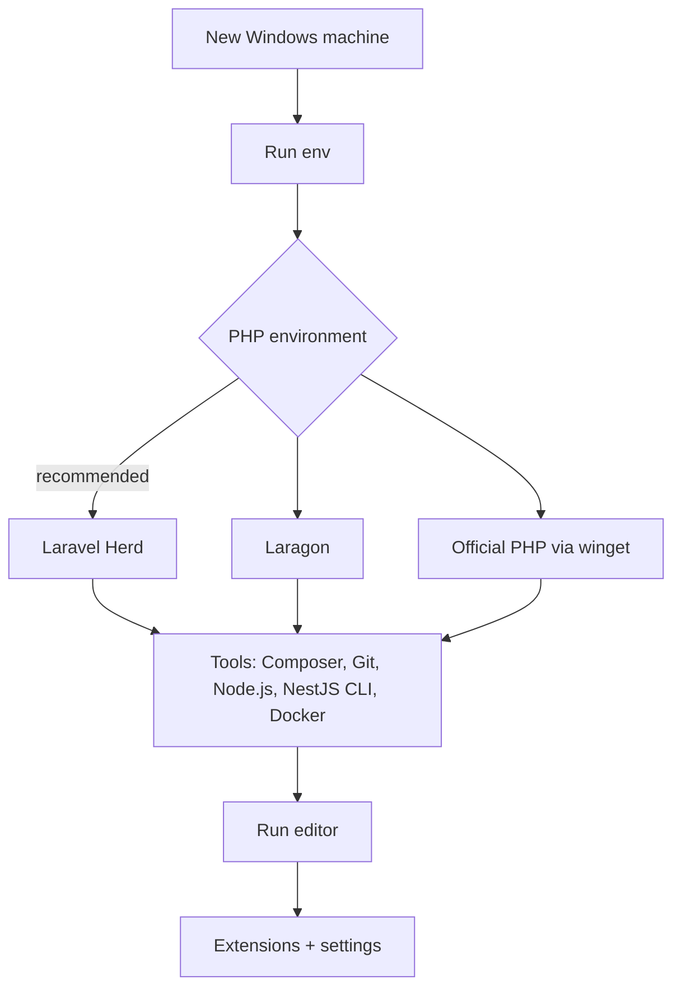

# How this repo is organized

## Tools, not one big script

The repo is a set of **independent tools**. Each top-level folder that contains a `.ps1` script is one tool.
Docs for a tool live in `docs/<tool>/`.

| Tool | Folder | Job | Docs |
|---|---|---|---|
| env | `env/` | Check and install dev tools (PHP environment, Composer, Git, Node.js, NestJS CLI, Docker) | [docs/env/usage.md](env/usage.md) |
| editor | `editor/` | Set up Cursor / VS Code extensions and settings | [docs/editor/usage.md](editor/usage.md) |

Why separate tools instead of one big script:

- **One job each.** Smaller scripts are easier to change and test.
- **Run only what you need.** If the machine already has Herd, run `editor` only.
- **One zip per tool.** A release ships `dev-setup-<tool>-vX.Y.Z.zip` for each tool folder (see [releasing](releasing.md)).

## Each script is self-contained

Every script works when downloaded alone as a single file (for example with the `irm ... -OutFile` one-liner).
So a script cannot import a shared module. The small helpers are **duplicated on purpose** in each script:

`Log`, `Ask-YesNo`, `Ask-Choice`, `Invoke-WithRetry`, `Wait-ForInternet`

If you fix a bug in one of them, apply the same fix in every tool.

## How tools call each other

Tools stay independent, but `editor` can start `env` when it needs it.

- `editor` checks for `php` and `node`. If one is missing it asks: "Run the dev tools setup (env) first?"
- It looks for env in this order: `../env/setup-dev-env.ps1` (clone), the same folder, then a download from the latest release.
- `env` exits with **0** when PHP and Node.js are both available, **1** otherwise.
- `editor` refreshes PATH and continues either way (it warns if something is still missing).
- `-SkipEnvCheck` turns the whole check off.

## Conventions every tool follows

| Convention | Detail |
|---|---|
| Version | A `$ScriptVersion = 'X.Y.Z'` line near the top, and a `-Version` flag that prints it. Same value in every tool; `build/bump-version.ps1` updates them. |
| `-Yes` | Accept every default and ask nothing. |
| Questions | Every question has a default; press Enter to accept it. |
| Logs | `%LOCALAPPDATA%\dev-ext-installer\` (`env-*.log`, `install-*.log`). |
| Network | Steps are retried (`-MaxRetries`) and the script waits for the internet to come back. |
| Consent | Never install anything without asking first (unless `-Yes`). |

## New machine, start to finish

Skipping the first step is fine: `editor` offers to run `env` automatically when PHP or Node.js is missing.

## Adding a new tool

1. Create a folder `<tool>/` with `setup-<name>.ps1` and a `.bat` launcher next to it.
2. Set `$ScriptVersion` to the same value as the other tools.
3. Support `-Version` and `-Yes`; give every question a default.
4. Copy the shared helpers (`Log`, `Ask-YesNo`, `Ask-Choice`, `Invoke-WithRetry`, `Wait-ForInternet`) so the script stays self-contained.
5. Write `docs/<tool>/usage.md`.
6. Add a row to the Tools table in `README.md`.
7. Add a line under `## [Unreleased]` in `CHANGELOG.md`.
8. Release packaging picks the new folder up automatically; no workflow change needed.
